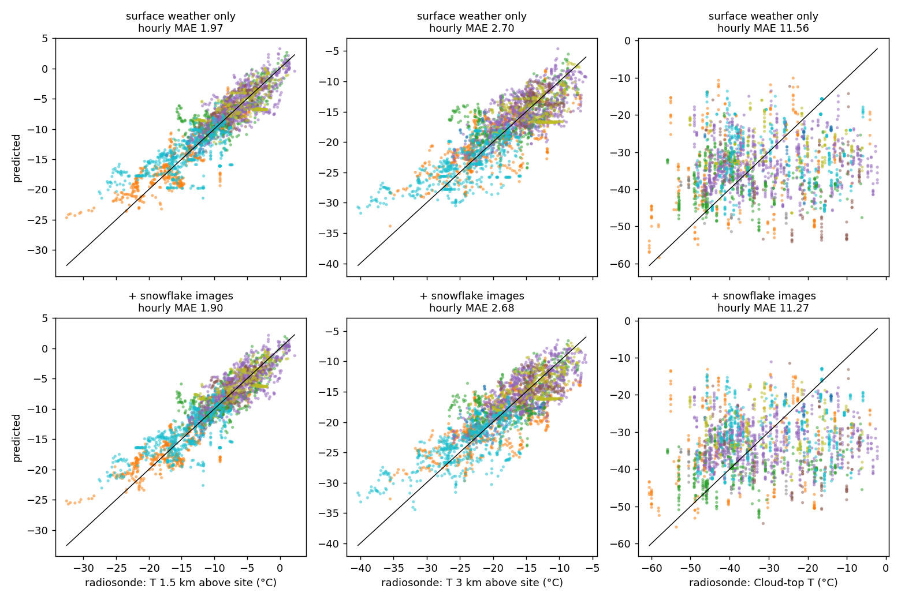
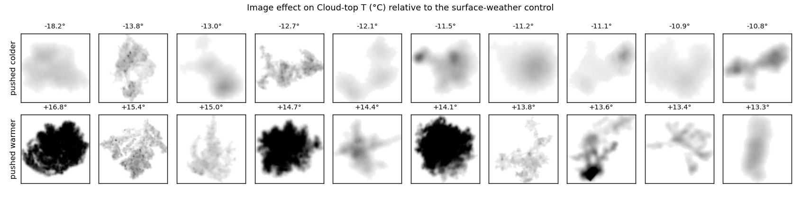
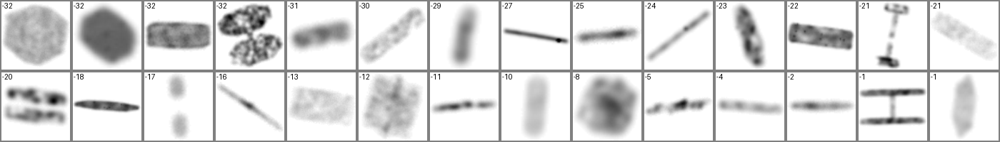

# Snowflake Letters

Can a neural network read the air above a mountain from photographs of the snowflakes falling on it?

Nakaya called snowflakes "letters sent from the sky": crystal habit depends on the temperature and humidity where the crystal grew. This project tests whether that letter is legible to deep learning in real field data, beyond what a weather station at the ground already says.

## Data

- **Snowflakes:** [MASCDB v1.1](https://zenodo.org/records/8083133), Multi-Angle Snowflake Camera triplets with hydrometeor class, riming and melting labels, plus co-located surface weather.
- **Truth aloft:** [IGRA2](https://www.ncei.noaa.gov/products/weather-balloon/integrated-global-radiosonde-archive) radiosondes. Dumont d'Urville and Davis are co-located with their MASC sites; Payerne is 32 to 80 km from the Swiss and French Jura sites.
- **Sample:** 130,926 dry, non-blowing-snow triplets from 8 campaigns, 2,853 snowy hours, 254 snow episodes.

Targets per snowflake, from soundings interpolated in time:
- temperature and RH at 0.5, 1.5 and 3 km above the camera;
- cloud-top temperature (top of the highest ice-saturated layer at least 300 m thick);
- column saturated fraction;
- whether a saturated dendritic growth zone (-18 to -12 C) was present.

## Design

- Cross-validation folds are grouped by **snow episode** (no gap over 6 h), not by day. 71% of snowy hours sit in storms that cross midnight; day-grouped folds leaked storms and inflated skill by about 0.3 C.
- **Control:** a gradient-boosting model on site, season and surface weather (T, RH, pressure, wind).
- **Image model:** a small three-view CNN with a shared encoder (the camera views are averaged and max-pooled) learns the control's residual. Base predictions for training rows come from an inner cross-validation, so the network never sees a base fitted on its own label.
- **Matched ablation:** the same network with the image branch switched off.
- Scored per hour (predictions averaged over all particles in the hour), with 95% intervals from a bootstrap over episodes.

## Results

Hourly MAE (C for temperatures):

| Model | T 0.5 km | T 1.5 km | T 3 km | Cloud-top T |
|---|---|---|---|---|
| Site + season only | 4.16 | 4.06 | 4.66 | 10.87 |
| + surface weather (GBM) | 1.72 | 1.98 | 2.83 | 11.06 |
| + 37 MASCDB shape descriptors | 1.70 | 1.99 | 2.80 | 11.04 |
| Descriptors + site, no surface weather | 2.90 | 2.88 | 3.69 | 10.58 |
| NN on surface weather (ablation) | 1.72 | 1.97 | 2.70 | 11.56 |
| **NN + snowflake images** | 1.70 | **1.90** | **2.68** | 11.27 |

Image model minus its matched ablation (negative = images help):

| Target | Gap | 95% CI |
|---|---|---|
| T 1.5 km | -0.07 C (-3.5%) | [-0.15, +0.01] |
| T 3 km | -0.02 C | [-0.14, +0.10] |
| Cloud-top T | -0.29 C (-2.5%) | [-0.67, +0.07] |

The point estimate favours the images on all 7 targets, but no single interval excludes zero. The targets are correlated, so 7 for 7 is weaker evidence than it sounds. Against the GBM control, the images make no detectable difference.



## What this says

1. **Snowflake shape does encode the air aloft.** Without surface weather, descriptors alone cut the error at 1.5 km by 30%. For cloud-top temperature they are the only inputs that beat climatology at all.
2. **At hourly resolution, almost all of that information is already in a ground weather station.** Pixels add at most a few percent.
3. **Single crystals, the cases where habit physics is sharpest, do not gain more than graupel or aggregates.** The supervised network is not learning Nakaya's diagram; it is learning a little about bulk microphysics.
4. **The galleries suggest what it does see.** Dense, bright, heavily rimed particles push the cloud-top estimate warmer, which is physically sensible: riming needs supercooled liquid, which is commoner in warmer clouds. Faint, out-of-focus particles push it colder, which may be a camera artefact.



## Limitations

- **Truth is coarse.** Swiss soundings are 30 to 80 km away; Dumont d'Urville soundings are once daily, so targets are interpolated over up to 13 h. This noise floor caps any image gain.
- **Few independent storms:** 254 episodes.
- **Classes are skewed.** Graupel and aggregates dominate; only 7% of triplets are clean single crystals, and many MASC frames are out of focus.
- The sounding grid stops at 8 km, so very high cloud tops are clipped.
- **Compute:** CPU-only training (64 px, 8 epochs). A larger model might find more, but the ablation shows there is little to find at this level of truth.

## Next step

Supervised learning against radiosondes looks capped by the truth, not the model. The route that could work is the original simulation-based-inference idea:
- train on synthetic crystals grown along known temperature and humidity paths;
- invert only the clean single crystals;
- validate against the co-located Antarctic soundings, or against campaigns with an intensive radiosonde programme such as ICEPOP-2018.

## Part 2: simulation-based inference on single crystals

The supervised route is capped by coarse ground truth, so part 2 never trains on soundings at all. It grows synthetic crystals from laboratory physics, learns to invert images to growth temperatures, and only then compares the inferred temperatures with the radiosondes.

**Simulator** ([src/habit.py](src/habit.py), [src/sim.py](src/sim.py)):
- **Attachment kinetics:** characteristic supersaturations s_char(T) for the basal and prism facets, from the polynomial fits of Harrington et al. (2019, J. Atmos. Sci., Table 1). Deposition coefficients follow Nelson and Baker (1996): alpha = (s/s_char)^m tanh((s_char/s)^m).
- **Diffusion coupling:** a common surface supersaturation balances attachment against vapor supply, alpha_diff = X0/R (Libbrecht 2005). Without this both axes saturate at alpha = 1 and every habit looks the same.
- **Axis growth** follows the facet hypothesis, dc/da = alpha_c / alpha_a. Branching grows with Lambda = s_env / s_surf, i.e. how diffusion-limited the growth is. Capped columns form when a columnar core moves into plate-growth conditions.
- **No tuning against the morphology diagram, yet it reproduces it:** plates near -2 C, columns near -6 C, thick plates at -10 C, the thinnest plates and strongest branching near -15 C, columns again below -22 C.
- **Two-stage temperature path:** core T1, outer T2. Nuisance priors cover lab-fit uncertainty, the ledge exponent, pressure, branching onset, seed size, orientation (falling plates, plus tumbling), MASC-like lighting, texture, imperfections, defocus and noise.
- 100,000 simulated triplets, rendered through the same crop pipeline as the real images.



**Inference** ([src/npe.py](src/npe.py)): a three-view CNN with a 10-component mixture-density head over (T1, T2), plus auxiliary habit heads.

On held-out simulations it is well calibrated (50% intervals cover 48 to 56%, 90% intervals cover 87 to 88%), but even there the image is only moderately informative: the posterior-mean error is 7.0 C against 8.3 C for the prior. The habit diagram is degenerate (plates at -2 C and at -12 to -20 C, columns at -6 C and below -22 C), so posteriors are often multimodal.

**Transfer check on real crystals** (no real labels used in training):

| MASCDB label | n | P(columnar) | P(capped) | branching |
|---|---|---|---|---|
| planar crystal | 3,879 | 0.03 | 0.40 | 0.74 |
| columnar crystal | 4,570 | 0.41 | 0.17 | 0.44 |
| columnar/planar combination | 1,453 | 0.22 | 0.71 | 0.62 |

Plates and capped columns transfer. Columns only partly do: many real columns are read as plates.

**Sounding test** ([src/validate_sbi.py](src/validate_sbi.py)), fixed before results:
- The score is the posterior mass that T2 puts on temperatures where the matched sounding is ice-supersaturated above the site.
- It is averaged within snow episodes, and episodes are weighted equally.
- The null shuffles soundings between episodes within a campaign. Any posterior that ignores the image gives exactly the null value; a dry run showed that a naive crystal-weighted version was biased by storm size.

| Subset | Crystals / episodes | Matched vs shuffled | z | p | z expected if physics right |
|---|---|---|---|---|---|
| clean (class prob > 0.8, light rime) | 761 / 79 | 0.373 vs 0.378 | -0.73 | 0.77 | 1.4 to 3.8 |
| all single crystals | 7,585 / 159 | 0.380 vs 0.377 | +0.69 | 0.24 | 4.1 to 5.4 |

The last column comes from a power check: each real crystal gets the posterior of a held-out simulation that grew at a temperature drawn from its own sounding's saturated layers.

The core temperature T1 reached p = 0.03 on the full set. That is one of four tests and does not survive correction.

**Verdict.** Under its own assumptions the test had the power to see the effect (expected z of about 4 to 5 on the full set) and saw none. The posteriors on real crystals behave out of distribution: columnar crystals pile up at the prior edges (-32 and -1 C), and planar crystals peak near -10.5 C rather than in the -15 C dendrite band. The physics simulator reproduces the morphology diagram, and the habit heads partly transfer. Even so, temperatures inferred from real MASC images carry no detectable information about the clouds the radiosondes measured.

The likely culprits, in order:
1. Sim-to-real gap at MASC resolution (defocus, orientation, and real columns that do not look like simulated ones).
2. Crystals that tumble through many layers rather than following a two-stage path.
3. The 30 to 80 km and up to 13 h mismatch between camera and sounding, which also hit part 1.

Closing the first gap would take a domain-adaptation step or higher-resolution imagery (for example a holographic imager or a cloud-chamber dataset with known growth conditions) as a calibration set.

## Reproduce

```
python src/igra.py data/igra/<station>-data.txt data/igra/<station>.parquet
python src/match.py        # table.parquet: snowflakes + sounding targets + episodes
python src/baselines.py    # GBM ladder
python src/extract.py 8    # images.npy from the MASCDB zarr (about 20 min)
python src/cnn.py scalar 8 12
python src/cnn.py image 8 12   # about 4 h on 12 CPU threads
python src/evaluate.py
python src/figures.py
python src/sim.py 100000 10 sims      # about 15 min
python src/npe.py train 6 12          # about 85 min on CPU
python src/npe.py heldout
python src/npe.py apply
python src/validate_sbi.py
```
